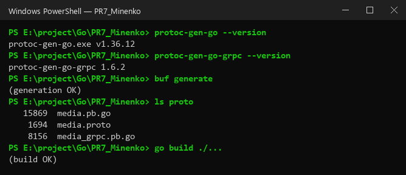
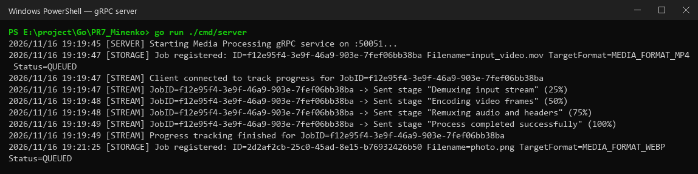
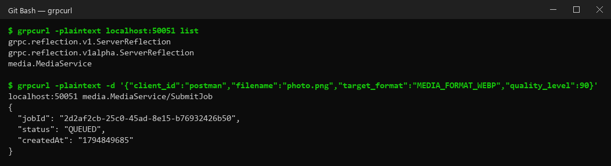
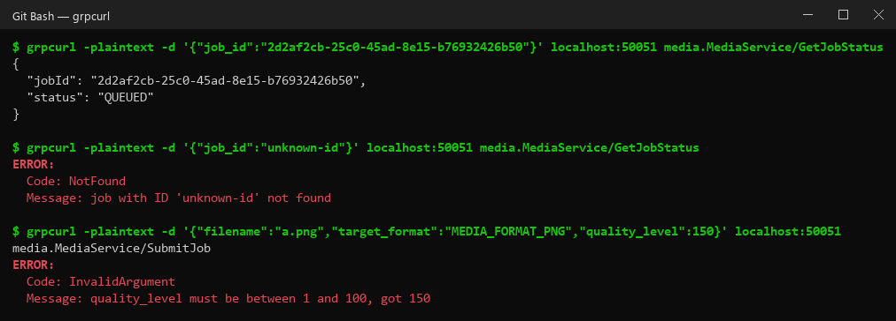
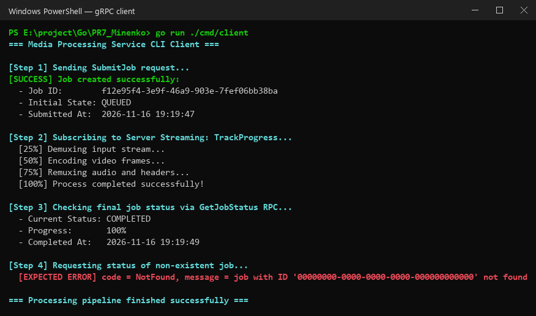
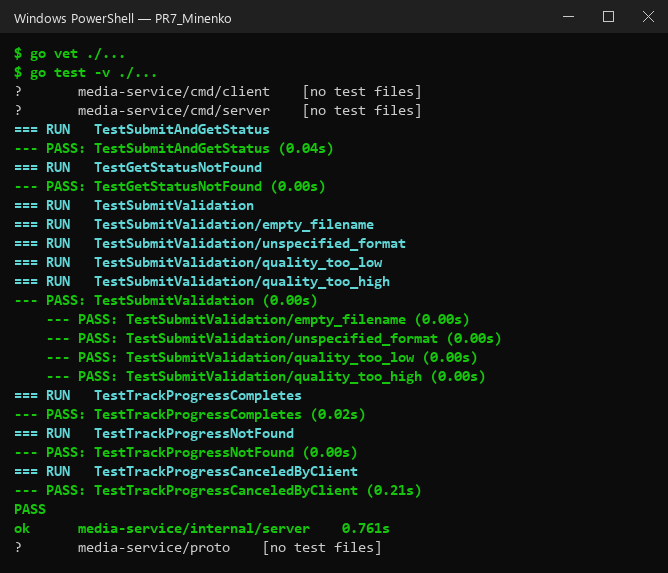

# Практична робота № 7
## Тема: Реалізація міжсервісної взаємодії за протоколом gRPC
### (Реалізація: Рівень 1 та Рівень 2)

---

## Зміст
1. [Мета роботи](#мета-роботи)
2. [Опис реалізованої системи (Рівні 1 та 2)](#опис-реалізованої-системи-рівні-1-та-2)
3. [Структура проєкту](#структура-проєкту)
4. [Контракт gRPC](#контракт-grpc)
5. [Покрокова інструкція із запуску](#покрокова-інструкція-із-запуску)
6. [Скріншоти роботи програми](#скріншоти-роботи-програми)
7. [Відповіді на контрольні питання](#відповіді-на-контрольні-питання)
8. [Висновок](#висновок)

---

## Мета роботи
- Опанувати концепцію віддаленого виклику процедур (RPC) та відмінності gRPC від REST API.
- Засвоїти мову опису інтерфейсів Protocol Buffers (proto3).
- Опанувати кодогенерацію плагінами `protoc-gen-go` та `protoc-gen-go-grpc`.
- Реалізувати серверні Unary-методи та потокові відповіді (Server Streaming RPC), а також клієнт на Go.

---

## Опис реалізованої системи (Рівні 1 та 2)

Розроблено внутрішній мікросервіс **обробки та конвертації медіафайлів (Media Processing Service)**, взаємодія з яким відбувається виключно за gRPC. Мережева взаємодія, серіалізація Protobuf і потоки — реальні; сама обробка файлу імітується покроковою зміною стану за таймером.

1. **Рівень 1 (Базовий: контракт, Unary RPC, сховище)**:
   - Go-модуль `media-service`.
   - Контракт `proto/media.proto` (proto3): enum `MediaFormat` (`UNSPECIFIED = 0`, `PNG`, `JPEG`, `WEBP`, `MP4`), повідомлення `ProcessMediaRequest`, `JobResponse`, `GetJobStatusRequest`, `JobStatusResponse`, сервіс `MediaService` з методами `SubmitJob` та `GetJobStatus`.
   - Код згенеровано плагінами `protoc-gen-go` та `protoc-gen-go-grpc` (`proto/media.pb.go`, `proto/media_grpc.pb.go`).
   - Сервер `cmd/server/main.go`: `net.Listen("tcp", ":50051")`, `grpc.NewServer()`, реєстрація сервісу; структура `MediaServer` вбудовує `pb.UnimplementedMediaServiceServer`.
   - Потокобезпечне сховище завдань `JobStore` (`map` + `sync.RWMutex`: `RLock` для читання, `Lock` для запису).
   - `SubmitJob` — валідація (`filename` непорожній, формат не `UNSPECIFIED`, `quality_level` 1..100, інакше `codes.InvalidArgument`), генерація UUID (`github.com/google/uuid`), статус `QUEUED`, Unix timestamp.
   - `GetJobStatus` — пошук за `job_id`; відсутнє завдання — `status.Errorf(codes.NotFound, ...)`.
   - Підключено **Server Reflection**, тому `grpcurl` і Postman працюють без завантаження `.proto`.

2. **Рівень 2 (Середній: Server Streaming та Go-клієнт)**:
   - Контракт розширено повідомленням `ProgressUpdate` (`job_id`, `current_stage`, `progress_percent`, `is_completed`) і методом `rpc TrackProgress(GetJobStatusRequest) returns (stream ProgressUpdate)`; код перегенеровано.
   - `TrackProgress`:
     - перевіряє існування завдання (`NotFound`);
     - переводить його в `PROCESSING` і за таймером проходить стадії 25% «Demuxing input stream», 50% «Encoding video frames», 75% «Remuxing audio and headers», 100% «Process completed successfully»;
     - на кожному кроці оновлює прогрес у сховищі та надсилає `stream.Send()`;
     - на 100% встановлює `COMPLETED` і `completed_at`;
     - слухає `stream.Context().Done()` — при розриві з'єднання обробка негайно зупиняється, статус стає `CANCELED`, повертається `codes.Canceled`.
   - Клієнт `cmd/client/main.go`: `grpc.NewClient()` з `insecure.NewCredentials()`, стаб `pb.NewMediaServiceClient(conn)`, послідовно `SubmitJob` → `TrackProgress` (цикл `stream.Recv()` до `io.EOF`) → `GetJobStatus`; додатково демонструє обробку помилки `NotFound` через `status.FromError`.
   - Автоматичні тести (`internal/server/service_test.go`) на `bufconn` (gRPC-сервер у пам'яті): Unary-методи, валідація, `NotFound`, повний потік прогресу, скасування потоку клієнтом.

---

## Структура проєкту

```text
PR7_Minenko/
├── proto/
│   ├── media.proto            # Контракт Protocol Buffers (proto3)
│   ├── media.pb.go            # Згенеровано protoc-gen-go (повідомлення, enum)
│   └── media_grpc.pb.go       # Згенеровано protoc-gen-go-grpc (клієнт, сервер)
├── internal/server/
│   ├── storage.go             # JobStore: map + sync.RWMutex
│   ├── service.go             # MediaServer: SubmitJob, GetJobStatus, TrackProgress
│   └── service_test.go        # Тести на bufconn
├── cmd/
│   ├── server/main.go         # gRPC-сервер :50051
│   └── client/main.go         # Консольний gRPC-клієнт
├── png/                       # Скріншоти для звіту
├── buf.gen.yaml               # Конфігурація кодогенерації для buf
├── go.mod / go.sum            # Модуль media-service
└── README.md
```

---

## Контракт gRPC

| Метод | Тип | Запит | Відповідь | Помилки |
|-------|-----|-------|-----------|---------|
| `SubmitJob` | Unary | `ProcessMediaRequest` | `JobResponse` | `InvalidArgument` |
| `GetJobStatus` | Unary | `GetJobStatusRequest` | `JobStatusResponse` | `NotFound` |
| `TrackProgress` | Server Streaming | `GetJobStatusRequest` | `stream ProgressUpdate` | `NotFound`, `Canceled` |

Життєвий цикл статусу завдання: `QUEUED` → `PROCESSING` → `COMPLETED` (або `CANCELED` при розриві потоку).

---

## Покрокова інструкція із запуску

### Крок 1. Інструменти кодогенерації
```powershell
go install google.golang.org/protobuf/cmd/protoc-gen-go@latest
go install google.golang.org/grpc/cmd/protoc-gen-go-grpc@latest
```
Каталог `%USERPROFILE%\go\bin` має бути в `PATH`.

### Крок 2. Генерація Go-коду з контракту
Згенеровані файли вже є в `proto/`; повторна генерація потрібна лише після зміни `media.proto`.

Варіант А — `protoc` (потрібно встановити Protocol Buffer Compiler, наприклад `winget install Google.Protobuf`):
```bash
protoc --go_out=. --go_opt=paths=source_relative \
       --go-grpc_out=. --go-grpc_opt=paths=source_relative \
       proto/media.proto
```
Варіант Б — `buf` (не потребує `protoc`, використовує ті самі плагіни та `buf.gen.yaml`):
```powershell
go install github.com/bufbuild/buf/cmd/buf@latest
buf generate
```

### Крок 3. Запуск сервера (Термінал № 1)
```powershell
go mod download
go run ./cmd/server
```
```text
[SERVER] Starting Media Processing gRPC service on :50051...
```

### Крок 4. Запуск клієнта (Термінал № 2)
```powershell
go run ./cmd/client
```

### Крок 5. Перевірка Unary-методів через grpcurl або Postman
```powershell
go install github.com/fullstorydev/grpcurl/cmd/grpcurl@latest
```
```bash
grpcurl -plaintext localhost:50051 list
grpcurl -plaintext -d '{"client_id":"postman","filename":"photo.png","target_format":"MEDIA_FORMAT_WEBP","quality_level":90}' \
  localhost:50051 media.MediaService/SubmitJob
grpcurl -plaintext -d '{"job_id":"<job_id>"}' localhost:50051 media.MediaService/GetJobStatus
grpcurl -plaintext -d '{"job_id":"unknown-id"}' localhost:50051 media.MediaService/GetJobStatus
```
**Postman:** New → gRPC → адреса `localhost:50051` → Service definition → Using server reflection → обрати метод → Message (JSON як вище) → Invoke.

### Крок 6. Автоматичні тести
```powershell
go vet ./...
go test -v ./...
```

---

## Скріншоти роботи програми

| № | Файл | Що показано |
|---|------|-------------|
| 1 | `1_buf_generate.png` | Версії плагінів, генерація коду, збірка без помилок |
| 2 | `2_server_logs.png` | Логи сервера: реєстрація завдань, стадії потоку |
| 3 | `3_grpcurl_unary.png` | `list`, `SubmitJob` через grpcurl |
| 4 | `4_grpcurl_errors.png` | `GetJobStatus` (успіх), `NotFound`, `InvalidArgument` |
| 5 | `5_go_client.png` | Go-клієнт: SubmitJob → TrackProgress → GetJobStatus |
| 6 | `6_go_test_passed.png` | `go vet` та `go test -v` без помилок |

#### 1. Кодогенерація


#### 2. Журнал сервера


#### 3. Unary-виклики через grpcurl


#### 4. Статус завдання та помилки gRPC


#### 5. Консольний Go-клієнт


#### 6. Автоматичні тести


---

## Відповіді на контрольні питання

### 1. Ключові відмінності gRPC від REST over HTTP/1.1
- **Модель:** REST адресує ресурси (`GET /jobs/1`), gRPC викликає віддалені функції (`GetJobStatus(req)`).
- **Формат:** REST зазвичай використовує текстовий JSON, gRPC — бінарний Protobuf (компактніший, швидша серіалізація).
- **Контракт:** у gRPC обов'язковий `.proto`, з якого генерується типізований код клієнта і сервера; у REST контракт необов'язковий (OpenAPI).
- **Транспорт:** gRPC працює лише поверх HTTP/2 з мультиплексуванням багатьох викликів в одному TCP-з'єднанні; REST/HTTP/1.1 обробляє один запит на з'єднання за раз.
- **Потоки:** gRPC нативно підтримує клієнтські, серверні та двонапрямлені потоки.
- **Помилки:** gRPC має стандартний набір кодів (`NotFound`, `InvalidArgument`, `Unauthenticated`...), REST — коди HTTP.
- **Браузери:** REST працює напряму, gRPC — лише через gRPC-Web/проксі.

### 2. Роль номерів полів і чому їх не можна змінювати
У бінарному форматі Protobuf імена полів не передаються — кожне значення кодується як пара «номер поля + тип кодування» (tag) та дані. Саме номер ідентифікує поле при декодуванні. Якщо після випуску змінити номер або використати старий номер для іншого поля, старі клієнти й сервери інтерпретуватимуть байти як інше поле — дані тихо зіпсуються або виникне помилка декодування. Тому номери незмінні; видалені поля позначаються `reserved`, нові додаються з новими номерами (поля 1–15 кодуються одним байтом, тому їх віддають найчастішим полям).

### 3. Скалярні типи vs `enum`; чому перше значення enum має бути 0
Скалярні типи (`int32`, `int64`, `string`, `bool`, `bytes`, `double`...) зберігають довільні значення свого типу. `enum` — це іменований набір допустимих цілочисельних констант (на дроті кодується як `varint`), що робить контракт самодокументованим і генерує типізовані константи (`pb.MediaFormat_MEDIA_FORMAT_MP4`).
У proto3 немає ознаки «поле присутнє»: поле зі значенням за замовчуванням не передається, а при декодуванні відсутнє поле отримує нуль. Тому значення за замовчуванням enum завжди 0, і перша константа повинна мати номер 0. Рекомендовано робити її `*_UNSPECIFIED`, щоб відрізнити «не задано» від реального значення — саме тому сервер відхиляє `MEDIA_FORMAT_UNSPECIFIED` з `InvalidArgument`.

### 4. Чотири типи RPC та застосування Server Streaming
1. **Unary** — один запит, одна відповідь (`SubmitJob`, `GetJobStatus`).
2. **Server Streaming** — один запит, потік відповідей (`TrackProgress`).
3. **Client Streaming** — потік запитів, одна відповідь (завантаження файлу частинами).
4. **Bidirectional Streaming** — незалежні потоки в обидва боки (чат, синхронізація).
Server Streaming застосовують для відстеження прогресу тривалих операцій, підписки на події та котирування, передачі великих результатів частинами, логів у реальному часі — замість періодичного опитування (polling).

### 5. Повернення помилок у gRPC і чому не варто повертати їх рядком у тілі
Обробник повертає `error`, створений через `status.Error(codes.X, msg)` / `status.Errorf`. gRPC передає код і повідомлення в трейлерах HTTP/2 (`grpc-status`, `grpc-message`), клієнт отримує їх через `status.FromError(err)` / `status.Code(err)`, за потреби — з деталями (`errdetails`).
Помилка рядком у тілі успішної відповіді: клієнт бачить «успіх» і змушений парсити текст; ламаються стандартні механізми — повтори, інтерцептори, метрики, балансувальники, які спираються на коди; втрачається сувора типізація контракту.

### 6. Що таке gRPC Metadata і як вона транспортується
Metadata — це пари «ключ → список значень» з контекстною інформацією виклику, що не є частиною бізнес-повідомлення: токени автентифікації, ідентифікатори трасування, мова тощо. Передаються як **заголовки HTTP/2** (HEADERS frame) на початку виклику, а відповідна серверна metadata — у заголовках або **трейлерах** відповіді. Ключі в нижньому регістрі; ключі із суфіксом `-bin` містять бінарні значення в Base64. Зарезервовані службові заголовки — `:path`, `content-type: application/grpc`, `grpc-timeout`, `grpc-status`, `grpc-message`. У Go: клієнт — `metadata.NewOutgoingContext`, сервер — `metadata.FromIncomingContext`.

### 7. Механізм Unary Interceptors
Інтерцептор — функція з сигнатурою `func(ctx, req, info *grpc.UnaryServerInfo, handler grpc.UnaryHandler) (any, error)`, яка підключається при створенні сервера (`grpc.UnaryInterceptor(...)` або ланцюжок `grpc.ChainUnaryInterceptor`). gRPC викликає її замість обробника; інтерцептор може виконати код до виклику (перевірити metadata, засікти час, отримати адресу через `peer.FromContext`), викликати `handler(ctx, req)` або повернути помилку без виклику (наприклад, `Unauthenticated`), і виконати код після (виміряти тривалість, залогувати код статусу). Так наскрізна логіка реалізується в одному місці, а не в кожному методі. Для потокових методів існують окремі `StreamServerInterceptor`. (Інтерцептори належать до Рівня 3 і в цій роботі не реалізувалися.)

### 8. Навіщо відстежувати `stream.Context().Done()` у потокових методах
Потоковий метод може працювати довго (у проєкті — кілька секунд на завдання). Якщо клієнт розірвав з'єднання, скасував контекст або вийшов дедлайн, продовжувати роботу немає сенсу: обчислення марні, горутина та пов'язані ресурси утримуються, а помилку `Send()` можна отримати не одразу. Перевірка `Done()` у `select` разом із таймером дозволяє миттєво зупинити обробку, звільнити ресурси і привести стан у коректний вигляд (у проєкті — статус `CANCELED`), що підтверджено тестом `TestTrackProgressCanceledByClient`.

---

## Висновок
Під час виконання практичної роботи № 7 (Рівні 1 та 2):
1. Спроєктовано контракт `media.proto` (proto3) з enum, повідомленнями та сервісом `MediaService`; згенеровано Go-код плагінами `protoc-gen-go` і `protoc-gen-go-grpc`.
2. Реалізовано gRPC-сервер на порту `:50051` з потокобезпечним сховищем завдань на `sync.RWMutex`.
3. Реалізовано Unary-методи `SubmitJob` (з валідацією та UUID) і `GetJobStatus` зі стандартними кодами помилок `InvalidArgument` та `NotFound`.
4. Реалізовано Server Streaming `TrackProgress` з покроковою імітацією обробки, оновленням стану та негайною зупинкою при розриві з'єднання.
5. Розроблено консольний Go-клієнт, що проходить повний сценарій: реєстрація завдання → читання потоку до `io.EOF` → перевірка фінального стану.
6. Коректність підтверджено ручним тестуванням (клієнт, grpcurl) та автоматичними тестами на `bufconn`.
